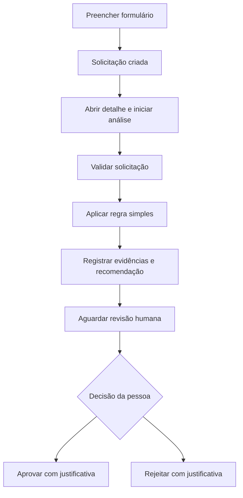

# Agent Review Lab — guia do projeto

Objetivo, escopo e roteiro do projeto. Para conduzir o trabalho, consultar
as [instruções de metodologia](../instructions/methodology.md); para retomar,
o [progresso](progress.md) e o [AGENTS.md](../../AGENTS.md).

## Objetivo e resultado esperado

Construir aplicação full-stack local que simule análise de crédito com execução
por etapas, eventos em tempo real e revisão humana. O objetivo principal é
**compreender e conseguir explicar conceitos e o caminho dos dados**.

O usuário é Senior Frontend Engineer, domina React e TypeScript, trabalhou com
Node/Express e conhece testes com Jest e React Testing Library. Sua experiência
com React vai até a versão 18. Agentes e FSD serão estudados desde os fundamentos.

O contexto é a preparação para conversa técnica de emprego, aparentemente sem
prova prática. Não exigir memorização, reprodução autônoma ou respostas a perguntas
de avaliação. Não planejar por carga horária.

O projeto também será portfólio no GitHub, com documentação legível, instruções
reproduzíveis, decisões justificadas e histórico compreensível. Executar localmente
e publicar código são ações distintas. Não haverá deploy da aplicação neste MVP.

### Resultado funcional

1. Criar solicitação com nome fictício, renda mensal e valor solicitado.
2. Consultar lista e abrir detalhe de cada solicitação por URL.
3. Iniciar análise por botão no detalhe, separadamente da criação.
4. Acompanhar etapas e evidências com feedback visual em tempo real.
5. Ver recomendação de aprovação ou rejeição produzida pelas regras.
6. Registrar decisão humana final com justificativa, inclusive discordando da
   recomendação, sem sobrescrevê-la.
7. Simular falha e iniciar nova tentativa manual, preservando o histórico.
8. Selecionar tentativa no detalhe para consultar suas etapas e resultado.
9. Simular desconexão e recuperar o estado ao reconectar.

## Escopo e arquitetura de referência

### Monorepo

Frontend, backend e documentação ficarão no mesmo repositório:

```text
apps/
  web/    Interface React executada no navegador
  api/    Servidor executado pelo Bun
docs/     Guia, progresso, conceitos e decisões
```

O monorepo facilita revisar mudanças de ponta a ponta e compartilhar tipos. Não
elimina os processos separados nem a comunicação por rede. Bun workspaces
administrará dependências e comandos, sem Nx ou Turborepo inicialmente.

`apps` é uma convenção, não uma exigência do runtime. Cada aplicação terá seu
manifesto; a raiz coordenará os workspaces, e o lockfile registrará a resolução
das dependências. A configuração será feita e explicada em M2 (Estrutura e ambiente, um passo por vez).

Não criar `packages/contracts` antecipadamente. Ao estudar tipos e schemas,
avaliaremos se existe código compartilhado que justifique um pacote.

### Responsabilidades previstas

| Tecnologia      | Responsabilidade                                                |
| --------------- | --------------------------------------------------------------- |
| React 19        | Renderizar interface e interações                               |
| TypeScript      | Verificação estática e tipos entre as partes                    |
| Vite            | Desenvolvimento e build da web                                  |
| Bun             | Runtime da API, dependências e testes de backend                |
| TanStack Router | Navegação, URLs e parâmetros                                    |
| TanStack Query  | Consultas, mutations, cache e atualização de estado de servidor |
| tRPC            | Operações tipadas entre frontend e backend                      |
| Zod             | Validar valores em runtime                                      |
| SSE             | Eventos de progresso do servidor para o navegador               |
| Tailwind CSS    | Estilos do backoffice                                           |
| Radix UI        | Componentes interativos conforme a necessidade                  |
| FSD adaptado    | Organização progressiva do frontend por responsabilidades       |
| Biome           | Formatação e análise estática                                   |
| Testing Library | Comportamento observável de componentes                         |
| Playwright      | Fluxos completos entre navegador e API                          |

A tabela descreve intenção de uso, não instalações simultâneas obrigatórias.

### Compartilhamento e comunicação são diferentes

```text
Durante o desenvolvimento:
tipos da API → verificação TypeScript do frontend

Com a aplicação em execução:
navegador → chamada HTTP/tRPC → API → operação e memória
navegador ← eventos SSE ← execução no servidor
```

Tipos não transportam dados nem validam JSON por conta própria. O compartilhamento
de tipos do router e possíveis schemas será discutido no passo de comunicação.
O frontend não deve incorporar o processo ou o executor do backend no seu bundle.

### Jornada de análise



Etapas terão pequenos atrasos intencionais no servidor para tornar o progresso
observável localmente. A interface refletirá eventos da execução, não um temporizador
independente que simula sucesso.

```text
✓ Validar solicitação       Concluída
◌ Aplicar regra             Em andamento
○ Registrar recomendação    Aguardando
○ Revisão humana            Aguardando análise
```

Recomendação de rejeição não é falha técnica: as regras concluíram a análise.
Desconexão não é falha da análise: o servidor pode continuar executando sem o
navegador receber eventos.

Controles visíveis e identificados como demonstração permitirão simular falha e
desconexão. Como acioná-los e garantir repetibilidade será decidido antes do código.
Todas as análises com recomendação aguardarão pessoa revisora, sem decisão final
automática. O histórico de tentativas ficará no mesmo detalhe da solicitação.

### Limites do MVP

- Um agente predefinido, regras determinísticas e repositório em memória.
- Reiniciar API apaga os dados; sem garantia durável de histórico.
- Sem modelo de IA real, banco, autenticação, Docker, integrações externas ou deploy.
- Sem editor, configuração, publicação ou versionamento de agentes.
- Sem múltiplos agentes no sistema simulado, grafos, colaboração ou ferramentas
  da vaga sem uso concreto.
- Dados fictícios e regras simples; sem pretensão de política de crédito de produção.

O simulador ensina orquestração, evidências, transportes e revisão. Não reproduz
raciocínio de LLM ou uso real de ferramentas externas.

## Roteiro por milestones

### M0 (Consolidar a descoberta em documentação)

**Propósito:** permitir retomada sem depender do histórico da conversa.

1. Revisar plano com o usuário.
2. Atualizar `AGENTS.md` com metodologia, limites e checkpoints.
3. Criar este guia central com objetivo, escopo, método e roteiro.
4. Atualizar progresso com estado da descoberta e próxima ação permitida.

**Validação e aceite:** documentos consistentes, links locais válidos e distinção
entre decisões aprovadas e escolhas futuras. Sem boilerplate, instalação ou código
de aplicação. Parar para revisão após registrar os documentos. Depois da aprovação,
a inicialização do Git e o primeiro commit documental serão um passo separado,
antecipado do M2 (Estrutura e ambiente, um passo por vez), sem execução automática.

### M1 (Visão conceitual do sistema)

**Propósito:** entender o sistema antes de configurar ferramentas.

1. Introduzir agente, modelo, ferramentas, execução, evidências e revisão humana.
2. Distinguir agente real de fluxo determinístico e explicar os limites do simulador.
3. Percorrer a jornada e distinguir recomendação de decisão humana.
4. Desenhar fluxo entre navegador, API, memória e eventos.
5. Introduzir monorepo e FSD conceitualmente, sem configurar suas partes internas.

**Registro:** produzir notas de fundamentos em `docs/concepts/` e registrar a
visão específica da aplicação em `docs/system/`, conforme estudarmos cada assunto.
Por exemplo, `docs/concepts/agents.md` explica agentes e seus conceitos;
`docs/system/overview.md` descreve o mapa da aplicação e seu fluxo de dados.
São destinos previstos, não arquivos a preencher antecipadamente. Usar exemplos,
diagramas e links sem duplicar especificações. Não dar uma aula de todas as
tecnologias de uma vez.

**Aceite:** visão geral revisada e usuário sinalizando conforto para iniciar a
fundação. Sem perguntas de avaliação ou implementação da aplicação.

### M2 (Estrutura e ambiente, um passo por vez)

**Propósito:** entender organização, instalação e execução dos projetos.

Cada item é um passo independente com explicação e revisão:

1. Definir e criar somente as pastas mínimas.
2. Diagnosticar disponibilidade do Bun e acesso ao registro de dependências.
3. Discutir e resolver impedimentos antes de prosseguir.
4. Verificar o Git inicializado após a revisão do M0 (Consolidar a descoberta em documentação) e configurar as exclusões
   pertinentes. Se a inicialização ainda estiver pendente, discuti-la em passo próprio.
5. Explicar manifests, dependências e workspaces; configurar monorepo.
6. Introduzir TypeScript nos dois ambientes e justificar suas opções.
7. Configurar Vite e página React mínima.
8. Criar servidor Bun mínimo e verificação técnica de saúde.
9. Configurar Biome e comandos básicos de qualidade.
10. Explicar origem, portas e comunicação local; configurar e verificar o
    encaminhamento necessário entre web e API.

**Validação:** instalação e lockfile, tipos, checks disponíveis, build da web e
smoke de web/API/comunicação local, conforme introduzidos.

**Aceite:** aplicações mínimas executando e comandos documentados, sem regras ou
telas de crédito. Nunca executar a lista inteira sem checkpoints entre os passos.

### M3 (Primeira comunicação tipada)

**Propósito:** acompanhar chamada do frontend até o backend e de volta.

1. Comparar operação tRPC com endpoint Express.
2. Introduzir Zod e distinguir tipos estáticos de validação runtime.
3. Montar operação mínima, sem começar pelo fluxo inteiro de crédito.
4. Explicar como o cliente conhece tipos de entrada e saída da API.
5. Demonstrar entrada válida, entrada inválida e erro.
6. Introduzir Query: estado de servidor, consulta, mutation, cache e invalidação.
7. Introduzir Router: URL, parâmetros e composição das páginas.
8. Avaliar fronteira de tipos e necessidade de pacote compartilhado.

**Validação:** demonstrar chamada real, validação e erros no nível adequado.
Verificar tipos com compilador, sem confundi-los com testes runtime.

**Aceite:** comunicação observável e tipada, validação demonstrada e notas sobre o
percurso da chamada. Código demonstrativo simples, preparando o fluxo seguinte
sem virar funcionalidade extra fora do escopo.

### M4 (Solicitações e backoffice básico)

**Propósito:** aplicar a comunicação a uma jornada pequena de produto.

1. Revisar cenários de criação, listagem e detalhe.
2. Definir modelo mínimo e repositório em memória.
3. Aplicar FSD progressivamente, justificando cada divisão.
4. Introduzir Tailwind e Radix nos componentes que precisarem deles.
5. Construir formulário, lista e detalhe em passos separados.
6. Tratar validação, carregamento, vazio, erro e solicitação inexistente.
7. Fazer recap de testes e introduzir Testing Library junto das interações.

**Validação:** criação e consulta na API; formulário, estados e interações nos
componentes; observar atualização do cache após criação.

**Aceite:** criar solicitação, vê-la na lista e abrir detalhe por URL. Backoffice
simples com HTML semântico e acessibilidade, sem etapa extensa de design visual.

### M5 (Execução simulada e histórico)

**Propósito:** separar iniciar a análise de executar o trabalho no servidor.

1. Definir estados, transições e cenários antes do código.
2. Especificar regra simples e evidências que justificam a recomendação.
3. Praticar TDD nas regras e transições escolhidas.
4. Criar etapas com atrasos didáticos no servidor.
5. Permitir início manual e consulta do estado da execução.
6. Introduzir falha controlada e seu controle de demonstração.
7. Permitir nova tentativa manual após falha, preservando histórico.
8. Mostrar e selecionar tentativas no detalhe da solicitação.

**Validação:** regras, transições válidas/inválidas, sucesso, falha e nova tentativa.
Consultar estado diretamente antes de introduzir o transporte de eventos.

**Aceite:** tentativas e evidências preservadas; falha distinta de rejeição; iniciar
retorna sem aguardar toda a análise. O progresso visual contínuo será conectado
em M6 (Progresso em tempo real e recuperação), sem adicionar polling obrigatório só para este milestone.

### M6 (Progresso em tempo real e recuperação)

**Propósito:** entender SSE e manter consistência durante desconexões.

1. Explicar requisição/resposta, polling, SSE e WebSocket, justificando o recorte.
2. Distinguir comando de início, execução no servidor e conexão de acompanhamento.
3. Definir contrato de eventos e validação dos payloads.
4. Decidir como snapshot e eventos serão reconciliados com o cache.
5. Implementar conexão e feedback visual por etapa.
6. Tratar abertura, desconexão, reconexão e encerramento.
7. Adicionar controle de demonstração de desconexão.
8. Verificar recuperação e limpeza de conexões ao navegar.

**Antes do código:** estudar ordenação, duplicação e janela entre snapshot e
inscrição. Reconexão SSE não é garantia automática de replay. Discutir estratégia
sem pressupor armazenamento durável.

**Validação:** acompanhar etapas reais, desconectar sem interromper servidor e
recuperar inclusive execução concluída durante a desconexão.

**Aceite:** interface reflete execução real, distingue conexão de falha de análise
e recupera estado ao reconectar.

### M7 (Revisão humana)

**Propósito:** completar o ciclo preservando recomendação e decisão final.

1. Definir quando execução pode ser revisada.
2. Exibir recomendação, motivos e dados considerados.
3. Permitir aprovação ou rejeição com justificativa.
4. Preservar separadamente recomendação e decisão humana.
5. Tratar submissão em andamento, erro e ações repetidas.
6. Verificar acessibilidade e uso com teclado.

**Validação:** impedir revisão antes da recomendação, registrar justificativa,
permitir discordância e tratar repetição conforme política discutida nesta etapa.

**Aceite:** toda análise concluída aguarda pessoa revisora; decisão final não apaga
ou altera recomendação original. Sem usuários/autenticação no MVP.

### M8 (Validação integrada e encerramento)

**Propósito:** consolidar funcionamento, aprendizado e portfólio.

1. Introduzir Playwright e explicar papel dos testes de ponta a ponta.
2. Validar criação, análise, recomendação e revisão humana.
3. Verificar falha, nova tentativa e recuperação nas camadas adequadas.
4. Revisar testes, tipos, build e qualidade.
5. Finalizar README com instalação, execução, testes, limitações e exemplos visuais.
6. Revisar notas, diagramas e decisões arquiteturais.
7. Fazer explicação guiada do caminho completo dos dados, sem avaliação.
8. Revisar preparo do repositório para publicação no GitHub.

**Aceite:** fluxo local completo funcionando, verificações passando, instruções
reproduzíveis e documentação compreensível para visitante do portfólio. Publicação
não é automática nem condiciona o funcionamento local do MVP.

## Organização dos documentos

| Local                | Responsabilidade                                            |
| -------------------- | ----------------------------------------------------------- |
| `AGENTS.md`          | Contexto do projeto e referências condicionais.             |
| `docs/project/`      | Escopo e roteiro neste guia; estado atual em `progress.md`. |
| `docs/instructions/` | Metodologia de trabalho e política de ADRs.                 |
| `docs/concepts/`     | Fundamentos das tecnologias e notas de aprendizado.         |
| `docs/system/`       | Funcionamento, fluxos e contratos específicos da aplicação. |
| `docs/adr/`          | Decisões arquiteturais e suas justificativas.               |

Criar conteúdo conforme o estudo e as decisões, organizado por assunto. Fluxos e
contratos têm fonte única em `docs/system/`; notas e ADRs podem referenciá-los.
Este guia é a especificação inicial; detalhar comportamentos antes de implementá-los.

### Decisões deliberadamente abertas

- Versões e opções de configuração das ferramentas.
- Organização interna de FSD, depois dos fundamentos.
- Contratos exatos de operações/eventos, tipos e eventual pacote compartilhado.
- Parâmetros da regra, duração das etapas e mecanismo de falha controlada.
- Transições detalhadas, concorrência e tratamento de ações repetidas.
- Estratégia de ordenação, recuperação e reconciliação de eventos.

Resolver no passo correspondente. Aprovar o roteiro não significa aprovar
antecipadamente essas escolhas técnicas.

## Evolução opcional após o MVP

Entrada em linguagem natural, por exemplo:

> Faça uma análise para Fulano, com renda mensal de R$ 10.000 e valor solicitado
> de R$ 100.000.

```text
Pedido em texto → extração dos campos → validação
                → esclarecimento de dados faltantes → confirmação → solicitação
```

Estudar extração, validação, esclarecimento e confirmação antes de agir.
Interpretar texto para preencher campos não equivale por si só a um agente que
escolhe ações e chama ferramentas.

Fora dos critérios de conclusão do MVP. Não sabemos se o produto da empresa usa
essa interface. Modelo real ou integração externa exigiria novo alinhamento,
sem instalação ou implementação antecipada.
