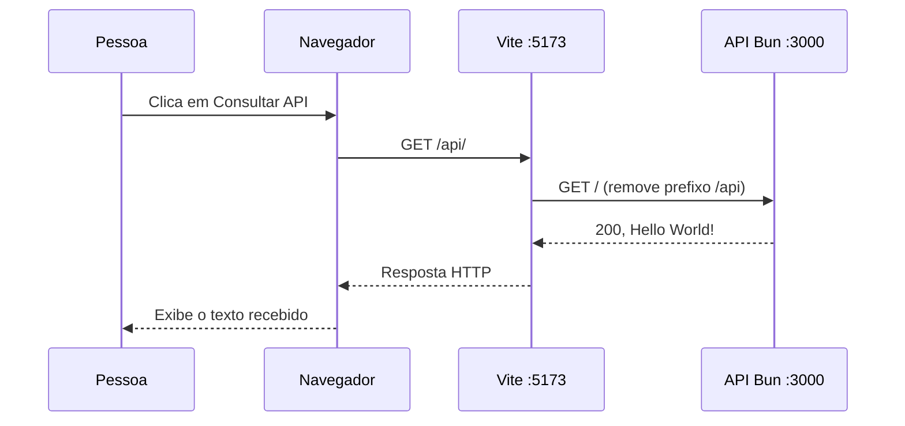

# Desenvolvimento local

Fundação implementada no M2 (Estrutura e ambiente, um passo por vez).
Os comandos ficam no [README da raiz](../../README.md) e nos READMEs da
[API](../../apps/api/README.md) e da [web](../../apps/web/README.md).

## Processos e endereços

- API: Bun, em `http://127.0.0.1:3000/`, restrita ao acesso local.
- Web em desenvolvimento: CLI do Vite executado por Node, em
  `http://127.0.0.1:5173/`; React executa no navegador.
- Bun inicia os dois scripts `dev` em paralelo a partir da raiz. Isso não une
  processos nem transforma imports TypeScript em comunicação de rede.
- Vite usa `strictPort`: se 5173 estiver ocupada, falha em vez de trocar a porta.
  Encerre instâncias anteriores antes de iniciar o comando conjunto.

## Contrato HTTP mínimo

`GET /` da API retorna status `200`, corpo `Hello World!` e conteúdo de texto.
Caminhos inexistentes caem no handler de fallback, que retorna `404` e `Not Found`.
Essa rota verifica disponibilidade HTTP, sem executar regras de crédito.

`Bun.serve` mantém o processo aguardando requisições. O handler retorna um
`Response`, que contém corpo, status e cabeçalhos. `start` executa o servidor;
`dev` usa `--watch`, reiniciando o processo após alterações de código.

## Consulta pela web e proxy

A interface usa `fetch` com caminho relativo. O proxy encaminha os caminhos
iniciados por `/api` para a API, removendo esse prefixo; `/api/` chega como `/`.
O navegador chama a origem da página e Vite faz o encaminhamento no servidor.
Não foi necessário acrescentar configuração de CORS ao backend para esse fluxo.

A seção de demonstração apresenta espera inicial, carregamento, sucesso ou erro.
O botão fica desabilitado durante a requisição. Respostas HTTP não bem-sucedidas
também são tratadas como erro: `fetch` não rejeita automaticamente por status 4xx
ou 5xx. Ao falhar, o botão permite uma nova consulta manual.

Com a API desligada, o proxy verificado retornou `502`; ao reiniciá-la, voltou a
responder `200`. Isso é falha de comunicação da demonstração, não uma análise de
crédito rejeitada ou uma tentativa de análise com falha.

O proxy está configurado no servidor de desenvolvimento. O build estático não
contém esse servidor; um eventual deploy exigiria definir o encaminhamento ou os
endereços apropriados. Não há deploy no escopo atual.

## Limites e próxima etapa

A página e o contador originais do Vite foram mantidos, com a seção de consulta
acrescentada. Não há tRPC, Zod, Query, Router, persistência ou fluxo de crédito
implementados. O M3 (Primeira comunicação tipada) introduzirá a comunicação tipada,
com explicação antes da alteração deste contrato demonstrativo.
