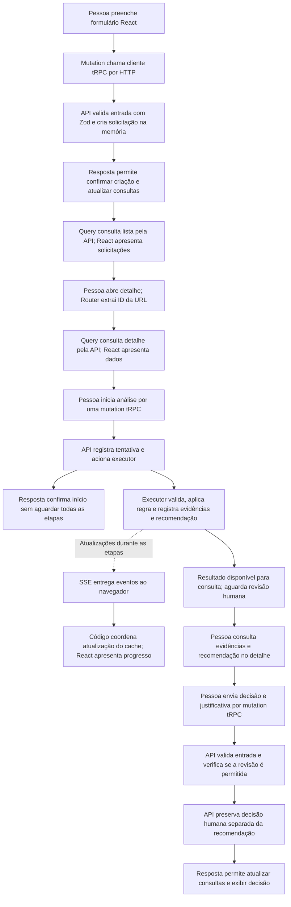
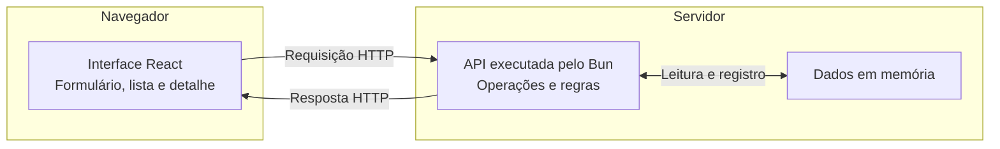
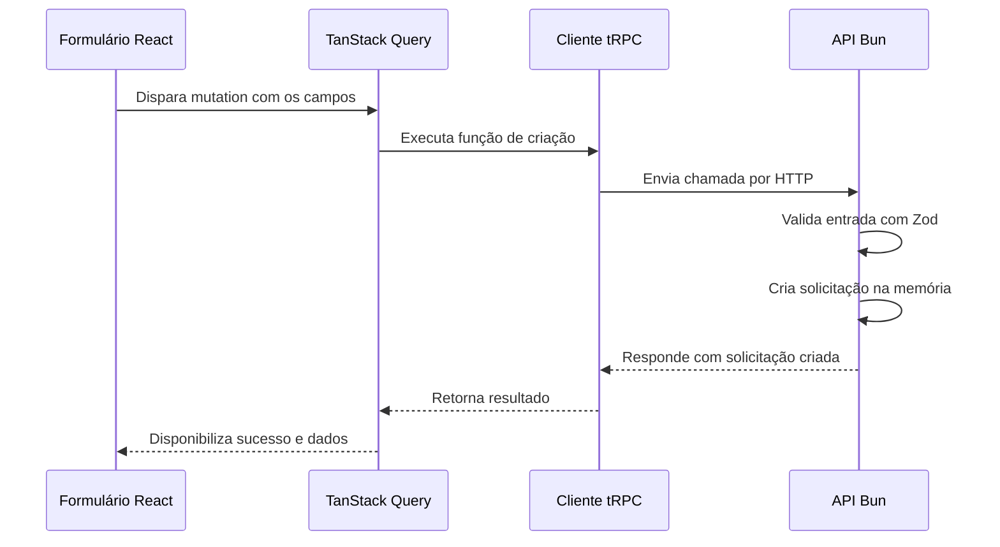
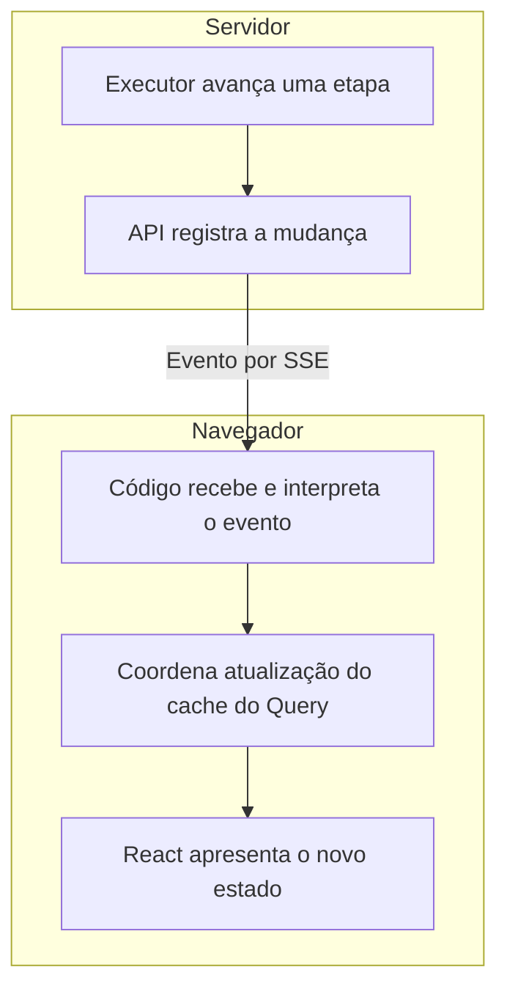
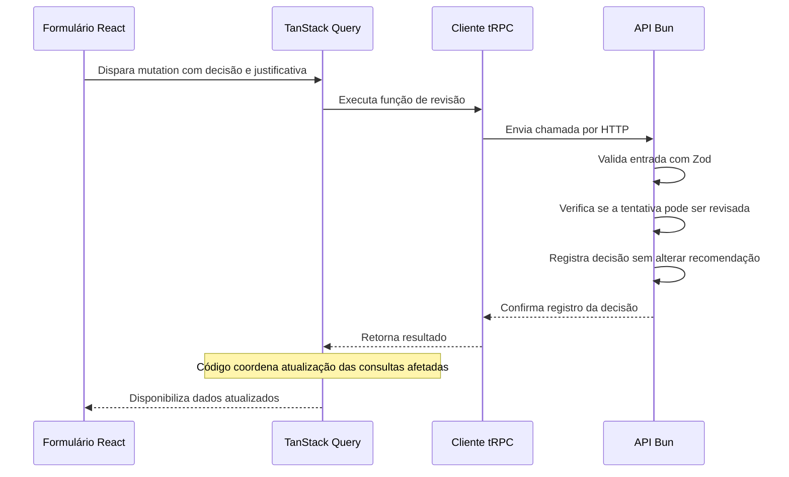

# Visão geral do sistema

O fluxo de crédito foi revisado conceitualmente no M1 (Visão conceitual do
sistema) e ainda não foi implementado. A demonstração do M3 (Primeira comunicação
tipada), descrita a seguir, exercita a comunicação com uma saudação. Comandos de
instalação, execução e verificação ficam no [README](../../README.md).

## Demonstração implementada no M3

### Fronteiras e contrato público

`apps/api` inicia o servidor Bun, conecta o Fetch Adapter e fornece os serviços.
`packages/trpc` contém routers, validação, formato de erros e interfaces do
contexto. `apps/web` apresenta a interface, acompanha consultas e navega por URL.

O pacote exporta `appRouter` e os tipos `AppRouter`, `Context` e `GreetingService`.
A entrada `@agent-review-lab/trpc/schemas` exporta o schema e os tipos de entrada
e saída da saudação, sem importar o router. O build do próprio pacote produz
JavaScript e declarações em seu `dist`; a web consome as declarações por
`import type`, sem analisar o fonte da API.

A API fornece um objeto compatível com `GreetingService` em `createContext`:

```ts
createContext: (): Context => ({ greeting: greetingService })
```

A interface do serviço é definida no pacote; sua implementação fica em
`apps/api/src/modules/greeting/service.ts`. O contexto criado por requisição
reutiliza a mesma referência de serviço. O pacote não importa a aplicação API.
Essa divisão prepara as próximas operações sem implementar módulos de crédito.
Os motivos e a reavaliação prevista estão na
[ADR 0002](../adr/0002-trpc-package-and-service-context.md).

### Caminho da chamada

```text
Home ou página de saudação
→ useQuery observa ["greeting", nome submetido]
→ queryFn chama o cliente tRPC, quando a busca é necessária
→ HTTP /api/trpc/greeting.hello
→ proxy Vite remove /api
→ Bun recebe /trpc/greeting.hello
→ Fetch Adapter conecta a requisição ao router e cria o contexto
→ Zod valida a entrada
→ procedure chama ctx.greeting.hello(input)
→ serviço da API aguarda dois segundos e produz a mensagem
→ resposta HTTP retorna ao cliente e ao cache
→ componente apresenta o resultado
```

O atraso pertence ao serviço da API; um resultado reaproveitado do cache não
aguarda esse atraso. O `GET /` técnico continua respondendo `Hello World!`.

A operação `greeting.hello` é uma query com entrada `{ name: string }` e saída
`{ message: string }`. O schema remove espaços das extremidades e exige pelo menos
um caractere. Digitar `123` no campo HTML produz uma string válida; enviar o número
`123` por HTTP é uma entrada inválida.

### Erros

A validação falha antes da chamada ao serviço e produz `BAD_REQUEST`, com HTTP
`400`. O formatter fornece uma lista de problemas independente de formulários:

```ts
validationIssues: [
  { path: ["name"], code: "invalid_type", message: "O nome deve ser um texto." }
]
```

`path` preserva campos e posições de listas; `[]` identifica a entrada inteira.
Não é o mesmo `path` de `error.data`, que identifica a procedure. Erros sem causa
Zod de entrada têm `validationIssues: null`. Erros internos recebem
`INTERNAL_SERVER_ERROR`, HTTP `500` e mensagem genérica, sem stack na resposta;
o adaptador registra os detalhes no terminal.

A home e a página de saudação mostram uma única mensagem: primeiro problema de
validação, mensagem da API ou fallback genérico. O tratamento detalhado de campos
fica para uma necessidade futura, mantendo a demonstração pequena.

### Consulta, cache e navegação

Na home, `name` controla o campo e `submittedName` identifica o nome confirmado.
`null` mantém a consulta inicial desabilitada; enviar uma string vazia permite
observar a validação da API. Editar o campo não muda a consulta observada.
Enviar outro nome muda a chave; enviar novamente o mesmo nome chama `refetch`
explicitamente, mesmo se o dado estiver fresh.

A consulta considera o dado atualizado por 30 segundos e desativa tentativas
automáticas. O QueryProvider mantém uma instância de QueryClient acima do Router.
Os dados permanecem no cache durante a navegação; o estado local da home reinicia
quando ela é desmontada. A interface usa `isFetching` para indicar busca e esconde
a saudação durante esse período, embora dados anteriores possam continuar no cache.

O Router conecta `/` à home e `/greetings/$name` à página de saudação. A rota extrai
`name` e o passa por props; a página observa as mesmas opções de consulta. Rotas
por arquivos em `app/routes` geram `app/routeTree.gen.ts` pelo plugin do Vite.
O arquivo é versionado e excluído do Biome; a
[ADR 0003](../adr/0003-file-based-routing.md) registra a escolha e sua revisão futura.
Caminhos não registrados mostram o
conteúdo de página não encontrada; em desenvolvimento, Vite ainda fornece o HTML
da aplicação para o Router decidir o conteúdo no navegador.

O Query Devtools está disponível em desenvolvimento. A invalidação foi observada
pelo painel: consultas ativas buscam novamente; inativas ficam marcadas para uma
próxima observação. Mutations e sua ligação com invalidação foram estudadas
conceitualmente; não foi criada uma mutation artificial para a saudação.

### Validação da fronteira

O pacote foi empacotado localmente e instalado em um consumidor temporário fora
do monorepo. As chamadas foram verificadas por TypeScript sem fontes da API, o
schema executou no Node e foi empacotado para navegador sem o router. O consumidor
usou bibliotecas TypeScript `ESNext` e `DOM`, necessárias aos tipos utilizados pelo
tRPC. Não houve publicação em registro nem deploy.

## Fluxo de crédito previsto

Este é o mapa de ponta a ponta. As seções seguintes detalham a comunicação e as
responsabilidades de cada parte. Contratos, estados e configurações exatos serão
definidos nos milestones de implementação.



O diagrama mostra a jornada e os caminhos dos dados, sem definir a ordem de
abertura da conexão SSE em relação às consultas. Essa coordenação será estudada
no M6 (Progresso em tempo real e recuperação).

Os registros de solicitação, tentativas, evidências, recomendação e decisão ficam
na API em memória. O cache do Query guarda cópias dos dados no navegador. Uma
consulta concluída pode informar que a execução está em andamento ou aguardando
revisão; o estado da consulta é independente do estado do trabalho.

Para aprofundar cada trecho:

- [Navegador, API e memória](#navegador-api-e-memória).
- [Criação e comunicação](#criação-e-comunicação).
- [Listagem e detalhe](#listagem-e-detalhe).
- [Início e execução](#início-e-execução).
- [Eventos e atualização da interface](#eventos-e-atualização-da-interface).
- [Evidências, recomendação e decisão humana](#evidências-recomendação-e-decisão-humana).

Os fundamentos das tecnologias e da organização do código estão no
[índice de conceitos](../concepts/README.md). Esta página concentra o fluxo
específico da aplicação.

## Navegador, API e memória



React apresenta a interface no navegador. Durante o preenchimento do formulário,
os valores ficam no estado da interface; a solicitação ainda não foi criada na API.
Ao enviar o formulário, o navegador transmite os dados para o servidor por HTTP.

Bun é o runtime que executará a API, assim como Node pode executar um servidor
Express. Navegador e API são programas separados, mesmo estando no mesmo monorepo.

Após uma criação bem-sucedida, a API mantém a solicitação na memória do seu
processo. A interface pode apresentar os dados recebidos na resposta e consultar
a API posteriormente para montar a lista ou abrir o detalhe.

Reiniciar a API apaga os dados em memória. Atualizar a página do navegador, por si
só, não apaga os dados mantidos pelo servidor.

Criar a solicitação e iniciar sua análise serão ações separadas.

## Criação e comunicação



Após a criação, a interface poderá invalidar a consulta da lista para buscar os
dados atualizados. O cache no navegador guarda cópias dos dados consultados; a
fonte das solicitações continua sendo a API. Os fundamentos estão em
[Comunicação e estado de servidor](../concepts/server-state.md).

## Consulta e acompanhamento da análise

### Listagem e detalhe

A listagem consulta as solicitações mantidas pela API. Ao selecionar uma delas,
a navegação abre seu detalhe por URL. Por exemplo, `/requests/req-1` identifica
a solicitação `req-1`; os caminhos e nomes definitivos ainda serão definidos.

TanStack Router identifica a página e extrai o identificador. A página usa esse
valor em uma query, cujo cliente tRPC consulta a API. React apresenta o resultado.
O ID também distingue entradas de detalhe no cache. A URL permite abrir o detalhe
diretamente, sem depender de uma visita anterior à lista, enquanto o dado existir
na API. Abrir o detalhe não inicia a análise.

### Início e execução

Solicitação é o registro dos dados a analisar. Tentativa é uma execução de análise
vinculada à solicitação. Executor é o código que coordena e realiza as etapas.

Ao receber o comando de início, a API registrará uma tentativa e acionará o
executor. A resposta voltará sem aguardar todas as etapas. O executor seguirá
validação, aplicação da regra e registro de evidências e recomendação; depois,
a análise aguardará revisão humana. A sequência será programada, sem IA real.
Estados, regras e mecanismo de execução serão definidos no
M5 (Execução simulada e histórico).

Uma consulta pode retornar com sucesso informando que a análise está em andamento
ou aguardando revisão humana. A requisição não precisa permanecer aberta até o
trabalho terminar.

O início será solicitado por uma mutation. A API executará as etapas, consultas
permitirão obter o estado atual e SSE entregará atualizações do servidor à
interface. A estratégia de reconciliação com o cache será definida no
M6 (Progresso em tempo real e recuperação).

### Eventos e atualização da interface

SSE atende ao acompanhamento porque o executor produz atualizações no servidor,
enquanto os comandos do usuário continuam em HTTP/tRPC. WebSocket também poderia
transportar essas mensagens, mas o fluxo atual não exige comandos pela mesma
conexão de acompanhamento. Os [fundamentos de SSE](../concepts/server-sent-events.md)
explicam os custos e limites dessa escolha prevista no guia.



Um evento poderá levar à invalidação de uma consulta ou à atualização de sua
entrada; isso ainda não foi decidido. Consultar estado, iniciar execução e
acompanhar eventos têm responsabilidades distintas.

## Evidências, recomendação e decisão humana

O executor registrará evidências e recomendação vinculadas à tentativa. Evidências
incluem os dados considerados e resultados da regra, permitindo compreender a
sugestão. O progresso informa o andamento das etapas; as evidências sustentam o
resultado. Parâmetros e regra concreta serão definidos no
M5 (Execução simulada e histórico).

Quando houver recomendação, a execução terá concluído seu trabalho e aguardará
revisão humana. A pessoa revisora poderá aprovar ou rejeitar com justificativa,
inclusive discordando da recomendação. A decisão humana será preservada
separadamente, sem apagar ou alterar o resultado original do executor.



Validar a entrada e verificar a possibilidade de revisão são responsabilidades
distintas: formato dos valores e regras do domínio. Contratos e políticas de
revisão serão detalhados no M7 (Revisão humana).
